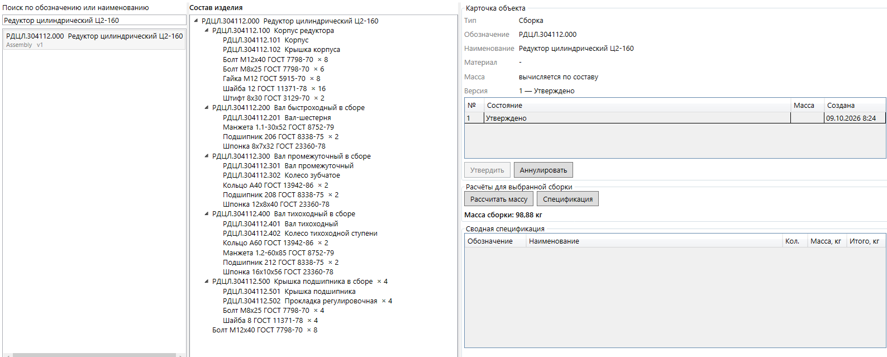
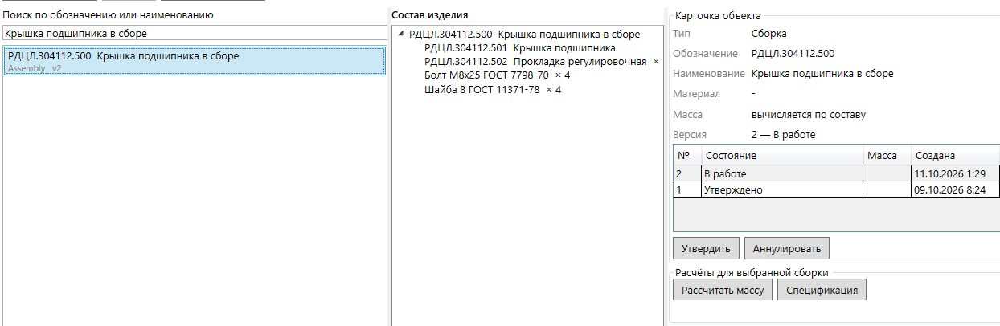
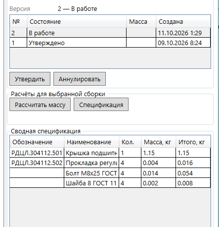
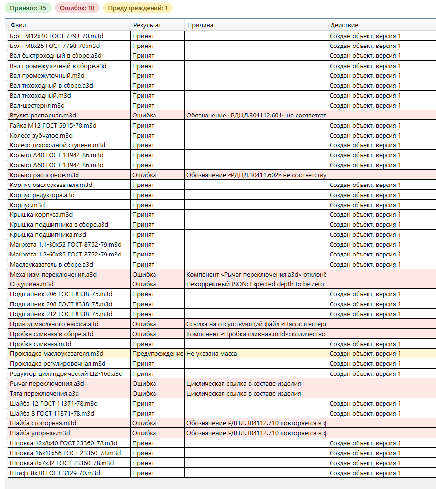
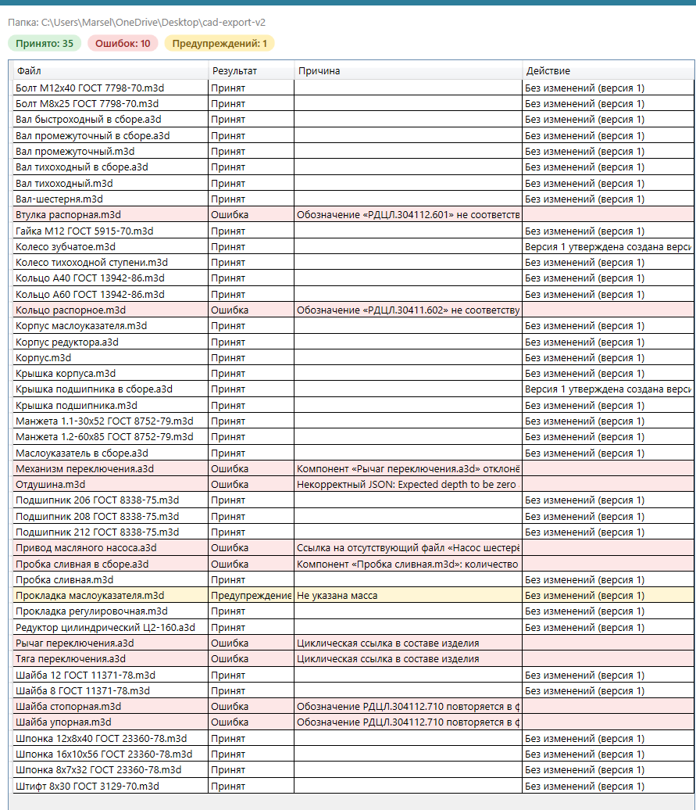

# Mini-PDM «Состав изделия»

Упрощённая система учёта конструкторского состава изделия: импорт эмулированных CAD-документов (JSON), хранение в SQLite, расчёты по дереву состава, десктопный клиент на WPF (MVVM).

## Требования к окружению

| Что нужно | Подробности |
|---|---|
| Операционная система | Windows 10 или 11. WPF запускается только на Windows |
| SDK | .NET 8 SDK |
| Сеть | Доступ к NuGet при первой сборке (`dotnet restore`) |
| СУБД | Устанавливать ничего не нужно: SQLite подключена пакетом `Microsoft.Data.Sqlite` |
| Права | Запись в `%LOCALAPPDATA%\MiniPdm` (там создаётся файл базы) |

Сборка на Linux и macOS возможна (в проекте включён `EnableWindowsTargeting`), запуск приложения только на Windows. Тесты не зависят от WPF и от файловой системы.

## Сборка и запуск

```
dotnet build
dotnet test
dotnet run --project src/MiniPdm.App
```

- Файл базы: `%LOCALAPPDATA%\MiniPdm\minipdm.db`. Путь можно переопределить переменной окружения `MINIPDM_DB`.
- Схема создаётся при старте скриптом `src/MiniPdm.Infrastructure/Sql/schema.sqlite.sql` (встроен в сборку, `IF NOT EXISTS`).
- Тесты используют SQLite в памяти, настройка не требуется.
- Импорт: кнопка «Импорт папки…», выбрать папку с файлами `*.a3d` и `*.m3d`.

## Структура проекта

| Проект | Назначение |
|---|---|
| `MiniPdm.Core` | Домен, импорт, расчёты, сервисы, интерфейсы (`ICadDocumentReader`, `IPdmStore`). Без зависимостей от пакетов |
| `MiniPdm.Infrastructure` | `JsonCadDocumentReader`, SQLite и Dapper |
| `MiniPdm.App` | WPF, MVVM (CommunityToolkit.Mvvm), композиция зависимостей вручную в `App.xaml.cs` |
| `MiniPdm.Tests` | xUnit |

## Соответствие требованиям задания

| Требование | Статус | Где и как |
|---|---|---|
| Абстракция над CAD-системой, остальной код не знает о JSON и файловой системе | Выполнено | `ICadDocumentReader` (Core), `JsonCadDocumentReader` (Infrastructure). Интерфейс изменён, обоснование ниже |
| Одна реляционная СУБД, схема скриптом | Выполнено | SQLite, `schema.sqlite.sql` |
| Дерево состава одним запросом с рекурсивным CTE | Выполнено | `SqlitePdmSession`, запрос дерева |
| Импорт папки в транзакции | Выполнено | `IPdmSession`: без `CommitAsync` происходит откат |
| Расчёт массы с учётом вложенности и количеств | Выполнено | `MassCalculator`, чистые функции |
| Сводная спецификация (количества перемножаются по пути и складываются) | Выполнено | `BomBuilder` |
| Обнаружение циклических ссылок | Выполнено | Алгоритм Тарьяна при импорте, признак `IsCycle` в дереве |
| Версии, состояния, переходы, повторный импорт | Выполнено | `ImportService`, `PdmService`. Проверено запуском (раздел «Отчёт импорта») |
| Формат обозначения, уникальность обозначений и наименований | Выполнено | `Designation`, `DocumentValidator`, проверка дубликатов при импорте |
| Деталь без массы: предупреждение; расчёт называет компонент без массы | Выполнено | Расчёт возвращает `null` и список компонентов без массы |
| Материал детали обязателен | Не выполнено | Валидатор материал не проверяет. См. «Не сделано» |
| Интерфейс: MVVM, дерево, карточка, смена состояния, поиск, импорт с отчётом, расчёт массы, спецификация | Выполнено | `MiniPdm.App`, логики в code-behind нет |
| Композиция зависимостей в одном месте | Выполнено | Вручную, `App.xaml.cs` |
| Тесты: расчёты, циклы, обозначения, состояния, импорт с подменой `ICadDocumentReader` | Выполнено | `MiniPdm.Tests`, импорт тестируется без файловой системы |
| Дополнительно: асинхронный импорт с прогрессом и отменой | Выполнено | Окно главной формы |
| Дополнительно: журнал импорта | Выполнено | Таблица `import_log` |
| Дополнительно: сохранение отчёта импорта в CSV | Выполнено | Кнопка «Сохранить в файл…» в окне отчёта |

## Скриншоты интерфейса

Главное окно: дерево состава «Редуктор цилиндрический Ц2-160», карточка объекта, расчёт массы.



Карточка «Крышка подшипника в сборе» после повторного импорта `cad-export-v2`: две версии, текущая версия 2 «В работе».



Сводная спецификация для той же сборки (количества и массы позиций).



## Отчёт импорта

### Набор `cad-export`

**Принято: 35, ошибок: 10, предупреждений: 1.** Предупреждение входит в число принятых (файл импортируется). У всех 35 принятых файлов действие «Создан объект, версия 1».



| Файл | Результат | Причина |
|---|---|---|
| Втулка распорная.m3d | Ошибка | Обозначение «РДЦЛ.304112.601» не соответствует формату: первая буква латинская P вместо кириллической Р |
| Кольцо распорное.m3d | Ошибка | Обозначение «РДЦЛ.30411.602» не соответствует формату: пять цифр вместо шести |
| Шайба стопорная.m3d | Ошибка | Обозначение РДЦЛ.304112.710 повторяется в нескольких файлах; отклоняются все такие файлы |
| Шайба упорная.m3d | Ошибка | То же обозначение РДЦЛ.304112.710 |
| Пробка сливная в сборе.a3d | Ошибка | Компонент «Пробка сливная.m3d»: количество не больше нуля (count = 0) |
| Привод масляного насоса.a3d | Ошибка | Ссылка на отсутствующий файл «Насос шестерённый НШ-10.m3d» |
| Рычаг переключения.a3d | Ошибка | Циклическая ссылка в составе изделия |
| Тяга переключения.a3d | Ошибка | Циклическая ссылка в составе изделия |
| Механизм переключения.a3d | Ошибка | Компонент «Рычаг переключения.a3d» отклонён |
| Отдушина.m3d | Ошибка | Некорректный JSON: файл оборван, не закрыты фигурные скобки |
| Прокладка маслоуказателя.m3d | Предупреждение | Не указана масса |

### Повторный импорт `cad-export-v2` (после утверждения версий)

**Принято: 35, ошибок: 10, предупреждений: 1.** Набор ошибок и предупреждение те же, что в первом импорте.



Действия над принятыми объектами:

- Без изменений (версия 1): 33 файла.
- Версия 1 утверждена, создана версия 2 «В работе»: 2 файла.

| Файл | Что изменилось | Результат |
|---|---|---|
| Колесо зубчатое.m3d | масса 5,86 → 5,92 кг | новая версия 2 «В работе» |
| Крышка подшипника в сборе.a3d | количество «Прокладка регулировочная» 3 → 4 | новая версия 2 «В работе» |

Родительские сборки («Вал промежуточный в сборе», «Редуктор цилиндрический Ц2-160») новых версий не получают: связь «входит в» ведёт на объект, а не на его версию, а в расчётах берётся текущая версия дочернего объекта.

### Как изменились расчёты для «Редуктор цилиндрический Ц2-160»

| Показатель | `cad-export` | `cad-export-v2` |
|---|---|---|
| Масса сборки, кг | 98,804 \* | 98,880 |
| Позиций в сводной спецификации | 25 \* | 25 \* |
| Всего штук в спецификации | 118 \* | 122 \* |
| «Прокладка регулировочная», шт. | 12 \* | 16 \* |

\* Значение получено расчётом по данным набора, а не снято с интерфейса. С интерфейса сняты: масса 98,88 кг для v2, количество «Прокладка регулировочная» 4 шт. в спецификации «Крышка подшипника в сборе», массы версий «Колесо зубчатое» 5,86 и 5,92 кг.

Рост массы на 0,076 кг складывается из колеса зубчатого (+0,06 кг) и четырёх прокладок регулировочных (4 × 0,004 = +0,016 кг).

## Архитектурные решения

- **СУБД: SQLite и Dapper.** Рекурсивные CTE поддерживаются, сервер устанавливать не нужно. Весь SQL лежит в одном классе (`SqlitePdmSession`). Поддержка PostgreSQL или MS SQL сводится к новой реализации `IPdmSession` с переписанными диалектными частями (рекурсивный CTE с путём предков, функция `lower_u`, получение идентификатора вставленной строки).
- **`ICadDocumentReader`** изменён: добавлен `ListDocumentsAsync`, метод `ReadAsync(location, documentId)`. Причина: перечисление папки тоже обращение к файловой системе, и оно не должно попадать в код импорта. `location` и `documentId` это непрозрачные строки (для JSON папка и имя файла, для реального API САПР что-то другое). Нечитаемый документ даёт `CadDocumentException`, импорт продолжается.
- **Дерево состава** выбирается одним рекурсивным CTE. Путь предков хранится строкой (`,1,5,9,`): по нему отсекаются циклы (повтор предка возвращается узлом `IsCycle` и дальше не разворачивается) и по нему же собирается дерево с количеством на каждом пути. Расчёт массы и спецификации выполняется в памяти над этим деревом (чистые функции, легко тестируются).
- **Импорт** выполняется в одной транзакции (`IPdmSession`; без `CommitAsync` происходит откат, в том числе при отмене). Этапы: чтение, проверки документов, дубликаты обозначений, конфликт типа с уже существующим объектом, распространение отклонений вверх до фиксированной точки, поиск циклов (Тарьян), повторное распространение, запись от листьев к корням.
- **Версии.** `current_version_id` обновляется при создании версии и при смене состояния (последняя неаннулированная; если таких нет, то NULL). Связь хранит дочерний объект, поэтому новая версия детали не требует новой версии сборки.
- **Масса** хранится как `REAL` (в SQLite нет decimal), в коде используется `decimal`.

### Принятые решения по неоднозначностям

- Масса не больше нуля у детали или стандартного изделия это ошибка; отсутствие массы это предупреждение.
- Масса, указанная у сборки, игнорируется (предупреждение).
- Дубликат файла в составе одной сборки это ошибка (пара «родитель + потомок» уникальна).
- Пустая сборка принимается с предупреждением.
- Обозначение у стандартного изделия игнорируется (предупреждение). Дубликаты наименований стандартных изделий отклоняются все, по аналогии с обозначениями.
- Имя объекта не версионируется: хранится в `pdm_object.name` и перезаписывается при импорте. Изменение только имени у утверждённой версии создаёт новую версию.
- Если объект с таким обозначением уже есть, но другого типа, файл отклоняется.
- Если все версии объекта аннулированы, повторный импорт создаёт следующую версию (n+1).
- Расчёт массы при отсутствии массы у компонента возвращает `null` и список компонентов без массы, а не 0.
- Число «Принято» в отчёте включает файлы с предупреждением: предупреждение не отклоняет файл.
- Поиск регистронезависим и для кириллицы (функция `lower_u`, потому что `LIKE` в SQLite понимает регистр только в ASCII).

## Реализовано из дополнительного

Асинхронный импорт с прогрессом и отменой, журнал импорта в таблице `import_log`, сохранение отчёта импорта в CSV.

## Не сделано (и как бы делал)

- **Проверка обязательного материала у детали.** Добавить правило в `DocumentValidator` (деталь без материала отклоняется) и тест на него.
- **Ленивая подгрузка дерева.** Сейчас загружается всё дерево выбранной сборки одним запросом. Для больших изделий загружать уровнями по `parent_version_id`.
- **Миграции схемы.** Схема применяется скриптом при каждом старте. Для будущих изменений добавить версионирование через `PRAGMA user_version` и пронумерованные скрипты.
- **Асинхронность запросов к SQLite.** Драйвер выполняет «асинхронные» методы синхронно, поэтому запросы поиска и загрузки дерева идут в потоке интерфейса. При росте данных вынести их в `Task.Run` или добавить debounce для поиска.
- PostgreSQL и MS SQL с выбором провайдера, docker-compose, Dapper с Jab, экспорт сводной спецификации в CSV или XLSX, сравнение версий, Serilog.

## Статус проверки

- `dotnet build` и `dotnet test` проходят без ошибок на Windows с .NET 8 SDK.
- Импорт `cad-export` и `cad-export-v2` выполнен вручную на чистой базе; результат (35 принято, 10 ошибок, 1 предупреждение; две новые версии после v2) приведён выше.
